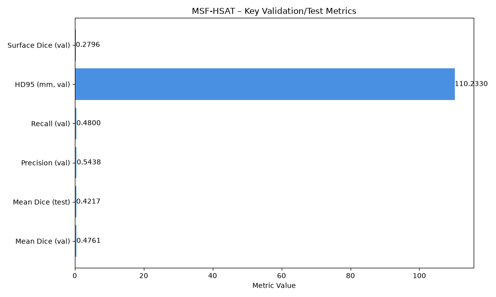
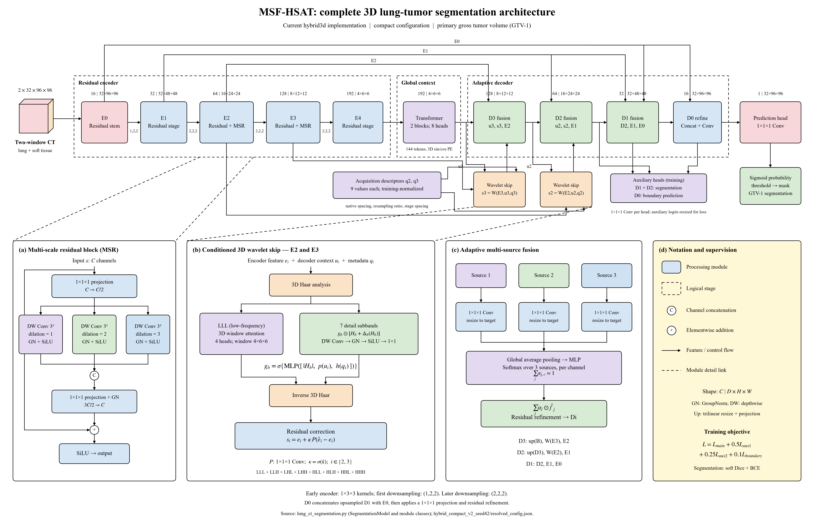

# MSF-HSAT

## 3D Lung Tumour Segmentation from CT Scans

**Multi-Scale Feature Fusion and Hybrid Spectral Attention Transformer**

A computer vision research project that learns to outline the annotated primary
lung tumour in a three-dimensional CT scan. Built with PyTorch, it covers the
complete experiment workflow: data preparation, training, native-resolution
prediction, evaluation, and visual reporting.

> **Research prototype, not a diagnostic tool.** This model predicts the annotated
> primary tumour volume (usually GTV-1). It does not diagnose cancer, classify
> benign versus malignant nodules, or identify every lesion in a scan.

[Overview](#project-overview) · [Architecture](#model-architecture) ·
[Dataset](#dataset-and-preprocessing) · [Results](#recorded-results) ·
[Setup](#installation) · [Workflow](#training-and-evaluation-workflow) ·
[Documentation](#project-structure-and-documentation)

## Results at a Glance

| Partition | Mean Dice | Median Dice | Precision | Recall | HD95 (mm) | Surface Dice |
|----------|----------|------------|-----------|--------|-----------|--------------|
| Validation (threshold 0.98) | 0.4761 | N/A | 0.5438 | 0.4800 | 110.23 | 0.2796 |
| Test (frozen 0.98) | 0.4217 | N/A | 0.4925 | 0.4586 | 110.00 | 0.2584 |

*All values are taken from the recorded experiments in `docs/RESULTS.md`. No clinical claims are made.*



## Project overview

A CT scan is a stack of slices forming a 3D image. A segmentation mask marks which
voxels belong to the target tumour. Unlike image classification, the output is
an outline throughout the volume, not one label for the entire scan.

This project uses small 3D patches during training to fit within available GPU
memory. During inference, it moves across the full scan with overlapping patches,
blends their predictions, and maps the result back to the original CT geometry.
It does **not** use a ground-truth tumour crop to locate the target at inference.

The implementation includes:

- **`hybrid3d`:** the proposed MSF-HSAT convolutional, transformer, and wavelet model.
- **`baseline3d`:** a residual 3D U-Net for controlled comparisons.
- **A reproducible pipeline:** patient-grouped splits, checkpoint/resume support,
  validation-only operating-point selection, metrics, and offline HTML reports.

The baseline is implemented, but matched baseline and ablation results are not
yet established. Implementing an architectural component does not prove that it
improves performance.

## Model architecture

[](outputs/figures/msf_hsat_architecture.svg)

*Architecture of the compact configuration. Open the image for a detailed view.*

| Component | What it does |
| --- | --- |
| Two-window CT input | Presents lung and soft-tissue intensity ranges as separate channels. |
| Residual 3D encoder | Extracts features at five spatial scales, with early anisotropic kernels. |
| Multi-scale feature blocks | Use different dilation rates to gather local information at several scales. |
| Bottleneck transformer | Relates spatial features across the compressed patch representation. |
| Conditioned wavelet skips | Separate coarse/detail features with 3D Haar transforms; refine them using attention, decoder context, and acquisition descriptors. |
| Adaptive decoder fusion | Learns per-channel weights for combining decoder and encoder feature sources. |
| Segmentation head | Produces voxel-wise logits, converted to probabilities and a binary mask. |

Two auxiliary segmentation heads and a boundary head provide additional
supervision during training. The objective combines soft Dice and binary
cross-entropy with weighted auxiliary and boundary losses.

The recorded **compact** configuration uses a `32 × 96 × 96` voxel patch,
encoder widths `16/32/64/128/192`, and **6,955,694 parameters**. At the working
spacing, that patch covers `80 × 96 × 96 mm`. Larger presets exist, but their
availability is not evidence of better accuracy.

See the [detailed user guide](docs/USER_GUIDE.md) for the implementation background
and [controlled experiment plans](docs/EXPERIMENTS.md) for baseline/ablation recipes.

## Dataset and preprocessing

The recorded experiments use the
[TCIA NSCLC-Radiomics collection](https://www.cancerimagingarchive.net/collection/nsclc-radiomics/).
The dataset is obtained separately and is **not included in this repository**.

| Item | Recorded experiment |
| --- | --- |
| Target | Annotated primary gross tumour volume, GTV-1 |
| Eligible cases after project QC | 413 |
| Training / validation / test | 247 / 83 / 83 |
| Split policy | Grouped by patient and source identity; seed 42 |
| Working spacing, z/y/x | `2.5 / 1 / 1 mm` |
| Input channels | Lung window `[-1000, 400] HU` and soft-tissue window `[-160, 240] HU` |
| Supported ingestion | Paired NIfTI CT/masks, or raw CT with RTSTRUCT |
| Not implemented | DICOM SEG ingestion |

Preparation checks image/mask geometry, labels, and source provenance. Eligibility
is determined by those checks; 413 is the recorded usable cohort, not a promise
that every download or conversion produces the same count.

### What is the cache?

The processed cache stores reusable CT arrays, masks, and metadata on disk.
Training reads patches from these prepared arrays instead of repeatedly converting
the original scans. This reduces repeated preprocessing and helps keep RAM/VRAM
use bounded.

The **manifest** lists the prepared cases and their provenance. The **split file**
records which patients belong to training, validation, and test. These are separate
from the cached image arrays; preserve all three for reproducibility.

The local 413-case cache was restored and its audit passed, including 12 raw
geometry rechecks. That is a local verification record, not data shipped with Git.
See [data audits and recovery](docs/TRAINING_IMPROVEMENTS.md).

## Recorded results

**Latest recorded comparison: 7 November 2026.** Both runs completed 100 epochs.
The historical model selected epoch 90; the corrected model selected epoch 100,
using full-volume validation Dice at threshold 0.5.

Dice measures overlap between the predicted mask and reference: **0 means no
overlap; 1 means perfect overlap**. It is not classification accuracy.

### Matched validation comparison — 83 patients

| Evaluation policy | Previous compact model | Corrected compact model |
| --- | ---: | ---: |
| Mean patient Dice, threshold 0.50 | 0.3563 | **0.3774** |
| Mean patient Dice, validation-selected threshold 0.98 | 0.4648 | **0.4761** |
| Completely missed targets, threshold 0.98 | 7 / 83 | 7 / 83 |

No component removal was applied to these rows. The corrected run uses corrected
training-only acquisition statistics and a mixed sampler: 50% foreground-centred,
40% anatomical-background, and 10% uniform selection. These are selection
probabilities, not guaranteed observed patch fractions. This is **not** a
normalization-only comparison.

At threshold 0.98, the paired mean Dice difference is **+0.0113**, with a conditional
patient-bootstrap 95% interval of **[-0.0104, +0.0327]**. The interval includes zero:
the new model has a modest higher average, but a clear improvement is not yet
established. Its boundary metrics are slightly worse.

**Important interpretation:**

- The 0.98 threshold was selected on validation. Its higher score reflects an
  operating-point change, not additional learning or an independent test result.
- The corrected model completely misses 5 targets at 0.50 and 7 at 0.98.
- Keeping only the largest component raises corrected Dice to 0.4947 but increases
  completely missed targets to **23/83**. It is not recommended as a default.
- A historical test evaluation recorded Dice **0.4217** at its frozen 0.98
  threshold. **No corrected-model test result is reported.** Do not use the
  historical test results to choose new settings.

See [full results, provenance, and limitations](docs/RESULTS.md) for precision,
recall, surface metrics, checkpoint hashes, and comparison details.

## Installation

Use Python **3.11 or 3.12** in a dedicated virtual environment. Commands below use
Windows PowerShell and run from the repository root.

### 1. Clone and create an environment

```powershell
git clone https://github.com/Bhargav12-surya/CV-lung-segmentation-.git
cd CV-lung-segmentation-
py -3.12 -m venv .venv
.\.venv\Scripts\python.exe -m pip install --upgrade pip
```

### 2. Install dependencies

Install the PyTorch build appropriate for your OS and GPU using the
[official PyTorch installation selector](https://pytorch.org/get-started/locally/),
inside this environment. Then install the project requirements:

```powershell
.\.venv\Scripts\python.exe -m pip install -r requirements.txt
.\.venv\Scripts\python.exe -m pip check
```

GPU training requires a compatible CUDA-enabled build. On Linux, replace
`.\.venv\Scripts\python.exe` with `.venv/bin/python`. Other accelerator backends
are not advertised as supported.

### 3. Check the environment and code

```powershell
.\.venv\Scripts\python.exe lung_ct_segmentation.py doctor
.\.venv\Scripts\python.exe -m unittest discover -s tests -v
```

The latest local regression run passed **69 tests** without patient data or model
training. CI is configured for CPU checks on Python 3.11 and 3.12; see
[GitHub Actions](https://github.com/Bhargav12-surya/CV-lung-segmentation-/actions)
for actual remote run status.

The optional `self-test` command also checks mathematical operations, synthetic
imaging, and small model forward/backward/update paths. It is not a dataset
training run or an accuracy evaluation.

Dependency ranges are declared in `requirements.txt`, not locked to one
installation. Retain the environment record saved with each real experiment.

## Training and evaluation workflow

**These are commands to run deliberately, not actions performed by this README
update.** Preparation needs separately obtained data; training needs appropriate
hardware. Use fresh run/output paths. Do not recreate an existing experiment's
manifest or patient split just to retry training.

### 1. Prepare data and create a patient split

For a **new dataset setup only**, the raw CT + RTSTRUCT route is:

```powershell
.\.venv\Scripts\python.exe lung_ct_segmentation.py prepare `
  --dicom-root data/nsclc_radiomics `
  --output prepared/nsclc `
  --roi GTV-1 `
  --spacing 2.5 1 1 `
  --release "YOUR_ACTUAL_DATA_RELEASE"

.\.venv\Scripts\python.exe lung_ct_segmentation.py split `
  --manifest prepared/nsclc/manifest.json `
  --output splits/main.json `
  --seed 42 --val-fraction 0.2 --test-fraction 0.2
```

Replace `YOUR_ACTUAL_DATA_RELEASE` with the actual downloaded source version.
For paired NIfTI inputs and QC guidance, see the [user guide](docs/USER_GUIDE.md).
If the verified cache, manifest, and split already exist, **skip this step**.

### 2. Train one model

This example uses the corrected compact sampling recipe. Run it only when ready;
`--preflight` performs forward/backward/optimizer allocation checks **and then
continues into training**.

```powershell
.\.venv\Scripts\python.exe lung_ct_segmentation.py train `
  --manifest prepared/nsclc/manifest.json `
  --splits splits/main.json `
  --run runs/example_hybrid_seed42 `
  --model hybrid3d --preset compact --preflight `
  --max-epochs 100 --steps-per-epoch 1000 `
  --batch-size 1 --accumulation 2 --workers 0 `
  --seed 42 --lr 5e-5 `
  --foreground-probability 0.5 `
  --anatomical-background-probability 0.4 `
  --hard-negative-probability 0 `
  --val-every 10
```

`steps-per-epoch` counts microbatches, not optimizer updates. Gradient accumulation
combines two microbatches per update in this example. Validation selects `best.pt`;
`last.pt` supports resuming the original run. Existing checkpoints retain their
saved scientific settings, including acquisition statistics.

Change `--model` to `baseline3d` for the implemented residual U-Net. Fair comparisons
must also match the data split, training budget, sampling, and evaluation policy;
see [experiment planning](docs/EXPERIMENTS.md).

### 3. Evaluate the selected checkpoint on validation

```powershell
.\.venv\Scripts\python.exe lung_ct_segmentation.py evaluate `
  --manifest prepared/nsclc/manifest.json `
  --splits splits/main.json --partition val `
  --checkpoint runs/example_hybrid_seed42/checkpoints/best.pt `
  --output evaluations/example_val
```

The evaluation includes original-grid probability/mask exports, patient metrics,
aggregate metrics, and `report.html`. Training-patch loss is not the same as
full-volume validation performance.

### 4. Select and freeze an operating point on validation

An operating point specifies the probability threshold and postprocessing used
to turn probabilities into a mask.

```powershell
.\.venv\Scripts\python.exe lung_ct_segmentation.py select-threshold `
  --evaluation evaluations/example_val `
  --manifest prepared/nsclc/manifest.json `
  --splits splits/main.json `
  --output evaluations/example_operating_point.json `
  --thresholds 0.3 0.5 0.7 0.85 0.9 0.95 0.97 0.98 0.985 0.99 0.995 0.999 `
  --postprocess-modes none
```

The saved operating point binds the selection to its checkpoint and data/split
provenance. **Never select thresholds, postprocessing, or model settings on the
test set.** For a planned final test assessment, pass the frozen file through
`evaluate --operating-point`; see the [evaluation protocol](docs/EVALUATION.md).

## Baseline results (U‑Net)

| Metric | Value |
|--------|-------|
| Mean Dice (val) | TBD |
| Mean Dice (test) | TBD |
| Precision (val) | TBD |
| Recall (val) | TBD |
| HD95 (mm) | TBD |
| Surface Dice | TBD |

*Baseline results are not yet recorded; populate after a controlled baseline run.*

## Project structure and documentation

```text
.
├── lung_ct_segmentation.py    # Core CLI, data pipeline, models, training, evaluation
├── requirements.txt          # Dependency ranges
├── tests/                    # Synthetic regression tests
├── scripts/                  # Audit, recovery, planning, saved-validation analysis
├── docs/                     # Guides, results, protocols, and review notes
├── outputs/figures/           # Tracked architecture/methodology illustrations
└── .github/workflows/         # CPU verification workflow
```

| Read next | Purpose |
| --- | --- |
| [User guide](docs/USER_GUIDE.md) | Detailed concepts, input formats, architecture, and CLI background |
| [Results](docs/RESULTS.md) | Recorded experiments, metrics, provenance, and limitations |
| [Evaluation protocol](docs/EVALUATION.md) | Failure counts, frozen operating points, and paired comparisons |
| [Experiment plans](docs/EXPERIMENTS.md) | Controlled baseline, hybrid, and component-removal plans |
| [Training and data notes](docs/TRAINING_IMPROVEMENTS.md) | Sampling, audits, cache recovery history, and measured probes |
| [Verification review](docs/REVIEW.md) | What was checked and the scope of that evidence |

Some user-guide passages describe the original delivery environment. For current
verification and comparison policies, use the linked review and evaluation notes.

Generated directories such as `data/`, `prepared/`, `splits/`, `runs/`, and
`evaluations/` are local artifacts, not required tracked folders in a fresh clone.
The repository excludes patient data, patient-level predictions, credentials,
environments, and model checkpoints. It publishes only source, documentation,
tests, diagrams, and aggregate results.

## Limitations and next research steps

Small-target localization, false positives, and large boundary errors remain
important limitations. More complex architecture does not by itself establish
better performance.

Next priorities are to inspect missed targets, verify learning on explicitly
selected small **training** cases, and test one controlled change at a time.
Matched baselines, ablations, repeated seeds, and independent data are still needed.
Novelty, clinical usefulness, and superiority over published methods are **not
established**.

## Data attribution and code licensing

Credit the NSCLC-Radiomics collection and follow its source citation and usage
terms. Dataset rights are separate from rights to this implementation; do not
redistribute patient data through this repository.

No code licence has been assigned in this repository. Public availability alone
does not grant general reuse rights; the owner should choose an appropriate
licence before offering those rights.
